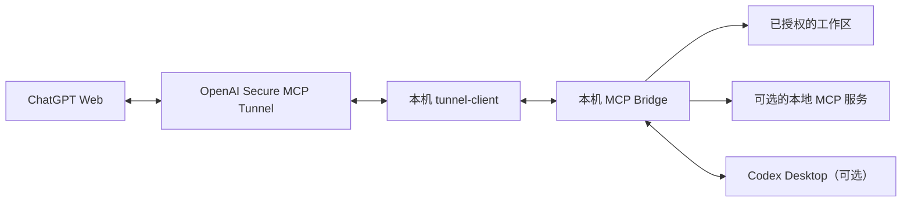

# ChatGPT MCP Bridge

ChatGPT MCP Bridge 是运行在本机的 MCP 服务和桌面控制台。它把你明确授权的项目目录与开发工具，通过 OpenAI Secure MCP Tunnel 连接到 ChatGPT 的自定义 MCP 插件。ChatGPT 可以按工作区权限读取或编辑文件、检查 Git、执行获准的开发操作，并调用可选的本地 MCP 服务或 Codex Desktop 集成。

项目文件由本机 Bridge 访问；被读取的内容会作为工具结果发送到 ChatGPT。默认情况下，Bridge 的 HTTP 服务只监听本机回环地址，不需要把本地端口直接暴露到互联网。



- **Windows：** 桌面控制台，支持 x64 / ARM64。
- **macOS：** 原生桌面控制台，支持 Apple Silicon。
- **开源项目：** 使用 Apache-2.0 许可证；不是 OpenAI 官方产品。

## 功能概览

- **本地工作区：** 浏览、搜索、读取和编辑授权目录中的文件；读取图片与 PDF 内容。
- **Git：** 查看状态、差异和历史，并执行受控的暂存与提交操作。
- **开发操作：** 按权限运行配置的项目脚本和 Recipe；`trusted-dev` 还可执行开发命令、启动桌面应用并使用交互式终端。
- **本地 MCP：** 检测、加载和卸载配置的本地 MCP 服务，并将其工具调用转发给 ChatGPT。
- **Codex Desktop：** 在工作区显式启用且本机 Codex Desktop 可用时，查看模块、对话线程和任务状态，并执行支持的任务操作。
- **桌面控制台：** 管理连接、工作区与权限，查看 Bridge、Tunnel、MCP 和 Codex 状态及日志；支持全局 SSH 主机管理。

## 安装与首次使用

### 1. 准备环境

| 项目 | 要求 |
| --- | --- |
| Windows | x64 或 ARM64 |
| macOS | Apple Silicon（arm64） |
| 通用依赖 | Node.js 22+、Git、pnpm 11.19.0 |
| macOS 额外依赖 | Xcode Command Line Tools，用于构建原生桌面应用 |

- 安装 [Node.js](https://nodejs.org/) 和 [Git](https://git-scm.com/downloads)。
- 如果尚未安装 pnpm，在 PowerShell 或 Terminal 中执行：

```sh
npm install -g pnpm@11.19.0
```

- macOS 如果尚未安装 Xcode Command Line Tools，执行 `xcode-select --install`。

ChatGPT 自定义 MCP 连接需在 **ChatGPT Web** 中创建；能否创建及可用的读写权限取决于账号计划和工作区策略，详见 [OpenAI 官方说明](https://help.openai.com/en/articles/12584461-connecting-custom-mcp-servers-in-chatgpt)。

### 2. 获取源码并启动桌面控制台

在终端中执行：

```sh
git clone https://github.com/AresQQQQQ/ChatGPT-MCP-Bridge.git
cd ChatGPT-MCP-Bridge
```

然后按平台启动：

**Windows**

```powershell
pnpm install --frozen-lockfile
```

依赖安装完成后，双击项目根目录中的 `bridge-ui.cmd`，打开桌面控制台。

**macOS**

在 Finder 中双击项目根目录中的 `bridge-ui.command`，或在 Terminal 中运行：

```sh
./bridge-ui.command
```

首次启动会按需执行锁文件依赖安装和 `pnpm run ui:build`，构建原生控制台。首次打开应用时，请在系统文件夹选择器中选择当前 Bridge 仓库目录并完成授权。构建完成后，也可以直接打开生成的 `ChatGPT MCP Bridge.app`。

### 3. 在连接向导中配置 Tunnel

先在 [OpenAI Platform 的 Tunnel 设置](https://platform.openai.com/settings/organization/tunnels) 创建或选择 Tunnel，并将它关联到准备使用的 ChatGPT 工作空间。随后在 [API keys 页面](https://platform.openai.com/settings/organization/api-keys) 创建 Runtime API key。

在 Bridge 桌面控制台中点击 **连接向导**，填写 Tunnel ID 和 Runtime API key。健康检查端口默认是 `8080`；需要更改时，打开 **设置 → 连接设置**。

保存后，向导会按需下载官方 Tunnel Client、校验文件并初始化本机 Tunnel profile。Tunnel ID 和 Runtime API key 的用途不同；Runtime API key 保存在本机 `.env` 文件中，不要填入 ChatGPT 插件的认证栏。

创建 Tunnel 通常需要 Platform 组织的 **Tunnels Read + Manage** 权限；运行客户端或在 ChatGPT 中选择 Tunnel 需要 **Tunnels Read + Use** 权限。

### 4. 配置工作区和权限

在桌面控制台的项目/工作区管理中，编辑默认工作区或添加工作区：

1. 将根目录设置为希望授权的**实际项目目录**，并确认目录存在。
2. 设置一个唯一的工作区 ID。后续 ChatGPT 工具调用中的 `workspaceId` 必须与此 ID 完全一致。
3. 第一次验证建议使用 `readonly` 权限模式。

新配置默认工作区的根目录是 Bridge 项目目录（`.`），请确认它符合你的授权意图。不要直接开放整个用户目录或磁盘根目录。

### 5. 启动服务并检查状态

在桌面控制台点击 **启动服务**，确认 Bridge 和 Tunnel 均显示就绪。保持服务运行，再进行下一步。

### 6. 在 ChatGPT 中创建自定义 MCP 插件

打开 [ChatGPT Plugins](https://chatgpt.com/plugins)，按以下步骤操作：

1. 点击添加入口，选择 **Add custom MCP server**。
2. 输入名称，例如 `ChatGPT MCP Bridge`。
3. 在 **Connection** 中选择 **Tunnel**，再选择刚才配置的 Tunnel，或输入相同的 Tunnel ID。
4. 对本项目当前的 Tunnel 配置，认证方式选择 **No authentication**。
5. 阅读并确认风险提示，点击 **Create as a plugin**，检查发现的工具。

本机连接向导只配置 Bridge 与 Tunnel，不会替你创建 ChatGPT 插件。Tunnel 已就绪也不代表插件已经创建或工具调用成功。不要把本机地址 `http://127.0.0.1:3000/mcp` 当作 ChatGPT 云端可访问的 Server URL；连接类型应选择 Tunnel。ChatGPT 的连接流程详见 [OpenAI 官方指南](https://help.openai.com/en/articles/12584461-connecting-custom-mcp-servers-in-chatgpt)；Secure MCP Tunnel 的原理和权限说明见 [Tunnel 文档](https://developers.openai.com/api/docs/guides/secure-mcp-tunnels)。

### 7. 执行首次只读调用

在 ChatGPT Web 中新建对话，在输入框输入 `@` 并选择刚创建的 Bridge 插件，然后发送以下测试请求。将 `default` 替换为你实际配置的工作区 ID：

```text
请使用 ChatGPT MCP Bridge 完成只读验证：
1. 调用 list_workspaces 列出可用工作区。
2. 调用 get_workspace_info 检查工作区 ID 为 default 的信息。
3. 调用 read_file 读取该工作区中的 README.md，并概括其内容。
不要修改文件，也不要运行命令。
```

验证成功时，ChatGPT 应显示真实的 MCP 工具调用，并返回与本机配置一致的工作区信息和文件内容。如果项目没有 README.md，请将测试文件名替换为一个实际存在的说明文件。

## 安全说明

### 工作区权限

| 模式 | 允许的操作 |
| --- | --- |
| `readonly` | 读取、列出、搜索文件及 Git 检查；不允许文件写入和命令执行。 |
| `workspace` | 在工作区范围内受控写入文件、进行 Git 检查，并运行配置允许的项目脚本和 Recipe。 |
| `trusted-dev` | 包含 `workspace` 的能力，并增加开发命令、桌面应用启动、交互式终端和 SSH 操作。 |
| `handoff` | 读取文件、搜索、Git 检查和项目指令上下文；不允许普通源码写入或命令执行。 |

`trusted-dev` 下的命令以运行 Bridge 的操作系统用户身份执行，**不是操作系统沙箱**。只为可信用户启用，并仅授权必要的项目目录。即使使用只读模式，也应避免向 ChatGPT 提供不希望上传到对话中的文件。

### 凭据和本地配置

- **Runtime API key**：保存在本机 `.env`，用于 Tunnel Client 连接 OpenAI 控制平面。
- **Tunnel ID**：保存在本机 Bridge 配置中，用于识别要连接的 Tunnel。
- **ChatGPT 插件**：在 ChatGPT Web 中单独创建，并选择同一个 Tunnel。
- **本地配置文件**：`mcp-bridge.json`、`.env` 和 `.mcp-bridge-state/` 均属于本机配置或运行状态，已加入 Git 忽略规则。不要提交到版本库。
- **SSH 密码**：Windows 使用 Windows Credential Manager，macOS 使用用户 Keychain。首次连接会记录观察到的 SSH 主机密钥（TOFU）；这不能验证首次看到的密钥一定属于目标设备。首次连接前请通过可信渠道核实指纹；已信任的密钥发生变化时，Bridge 会拒绝连接。

Bridge 默认监听 `127.0.0.1:3000`，不要直接将本地 HTTP 服务暴露到公网。详细权限和安全边界见 [工具与权限参考](docs/REFERENCE.md) 与 [交互式终端和 SSH 说明](docs/INTERACTIVE-TERMINAL.md)。

## 更新与排查

### 更新

先停止 Bridge 和 Tunnel，并退出正在运行的桌面控制台。更新脚本要求当前分支为 `main` 且工作区没有未提交修改；它会检查远端变化并执行快进更新，不会自动覆盖本地提交或修改。

- **Windows：** 运行 `update-bridge.cmd`。
- **macOS：** 在项目目录中运行 `./update-bridge.command`。

更新脚本会按需安装依赖、构建、运行本机诊断，最后在终端启动 Bridge 与 Tunnel。若要返回桌面控制台，按 `Ctrl+C` 停止终端服务，再运行对应平台的桌面 UI 启动入口。

### 常见问题

- **Tunnel 已就绪，但 ChatGPT 没有工具：** 确认已创建并启用自定义 MCP 插件、当前对话已通过 `@` 选择插件，并且 Tunnel 关联到目标 ChatGPT 工作空间。
- **ChatGPT 找不到 Tunnel：** 检查 Platform 组织和 ChatGPT 工作空间关联，以及账号是否具有 Tunnels Read + Use 权限。
- **找不到工作区或文件：** 检查 `workspaceId` 是否与工作区 ID 完全一致、根目录是否存在，以及文件路径是否相对于该工作区根目录。
- **写入或命令被拒绝：** 检查工作区权限模式；`readonly` 不允许写入，普通 `workspace` 不开放 `trusted-dev` 的开发命令和终端能力。
- **macOS 控制台无法启动：** 检查 Node.js 22+、pnpm 和 Xcode Command Line Tools，然后退出已运行的应用并重新运行 `bridge-ui.command`。
- **SSH 提示主机密钥变化：** 先通过可信渠道核实新指纹，再有意识地更新本机 SSH 信任记录；不要直接忽略警告。

## 进阶文档

- [手动配置与维护](docs/SETUP.md)
- [工具、配置和安全参考](docs/REFERENCE.md)
- [交互式终端与 SSH 凭据](docs/INTERACTIVE-TERMINAL.md)
- [Windows 与 macOS UI 功能对照](docs/CROSS_PLATFORM_UI_PARITY.md)
- [ChatGPT 项目指令模板](docs/CHATGPT-PROJECT-INSTRUCTIONS.md)
- [许可证](LICENSE)

## 开发者验证（可选）

在仓库根目录执行：

```sh
pnpm install --frozen-lockfile
pnpm typecheck
pnpm test
pnpm build
```

构建 macOS 原生桌面控制台时执行 `pnpm run ui:build`。普通用户的启动步骤请参阅上面的平台专属流程。
